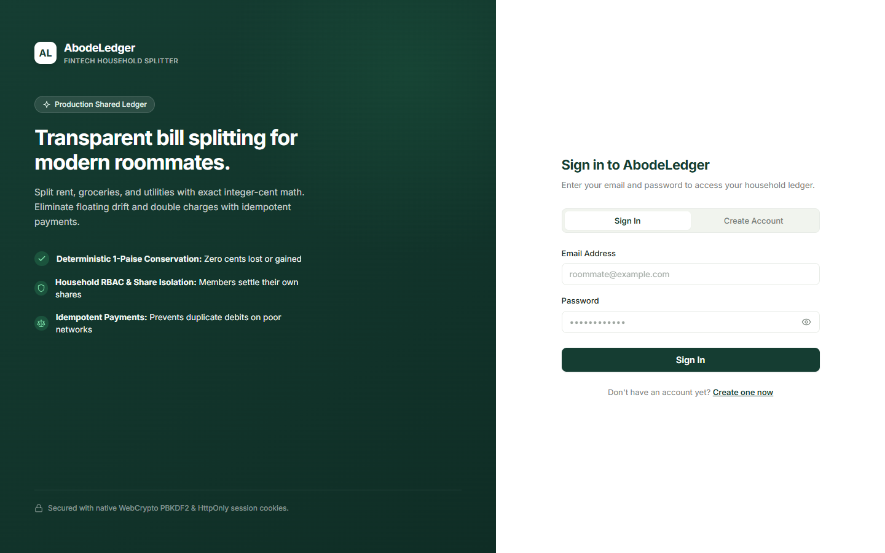
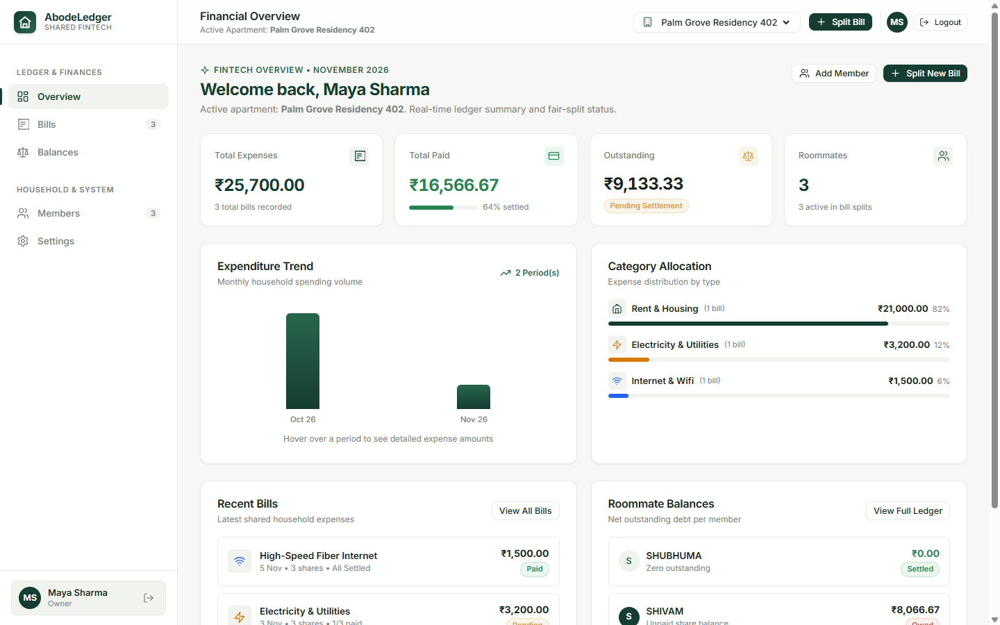
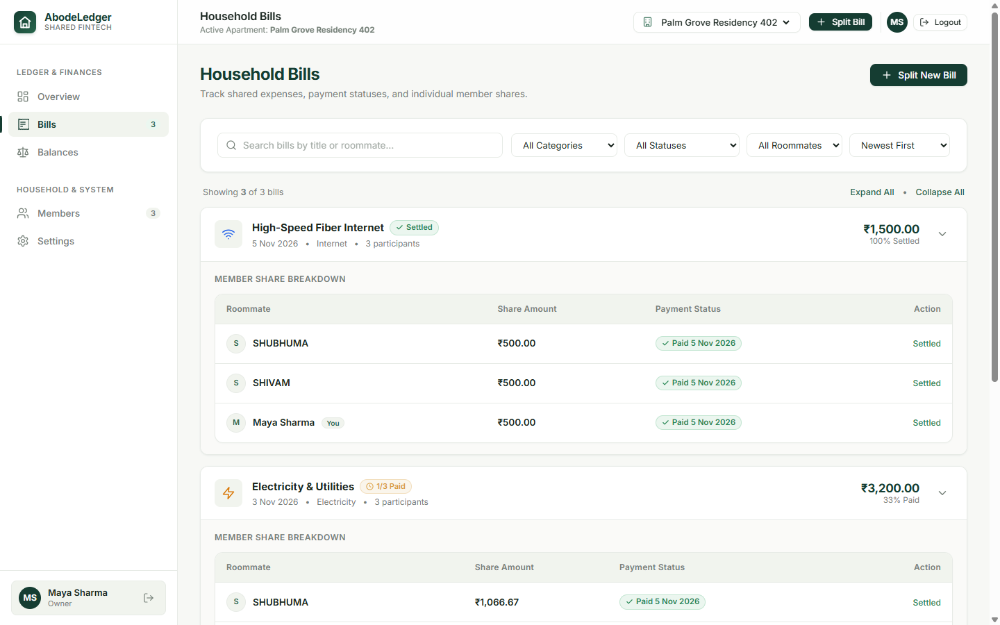
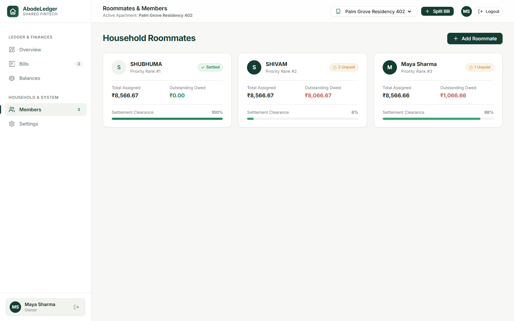
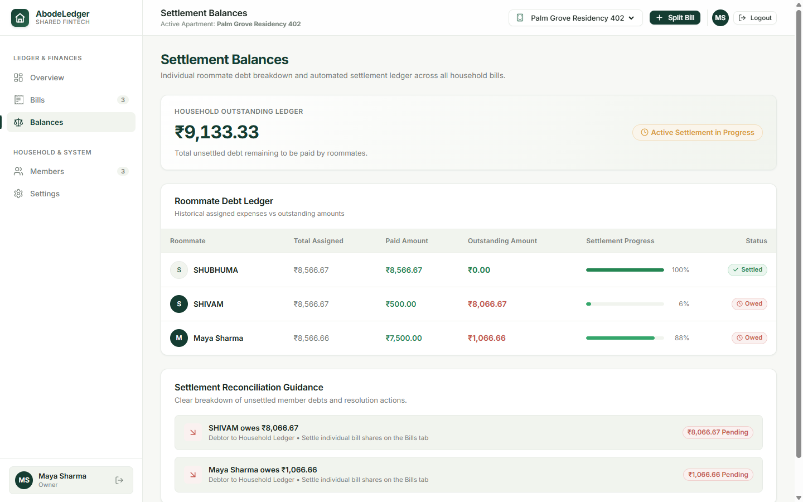
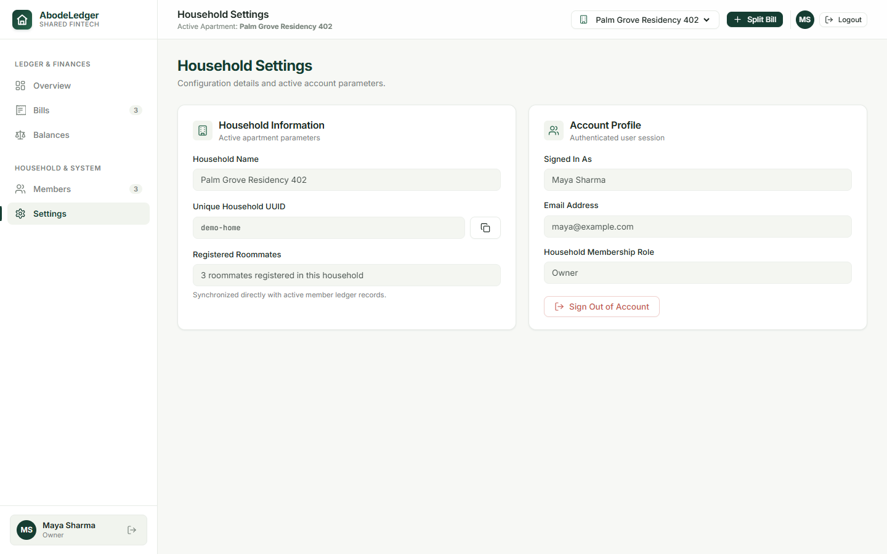
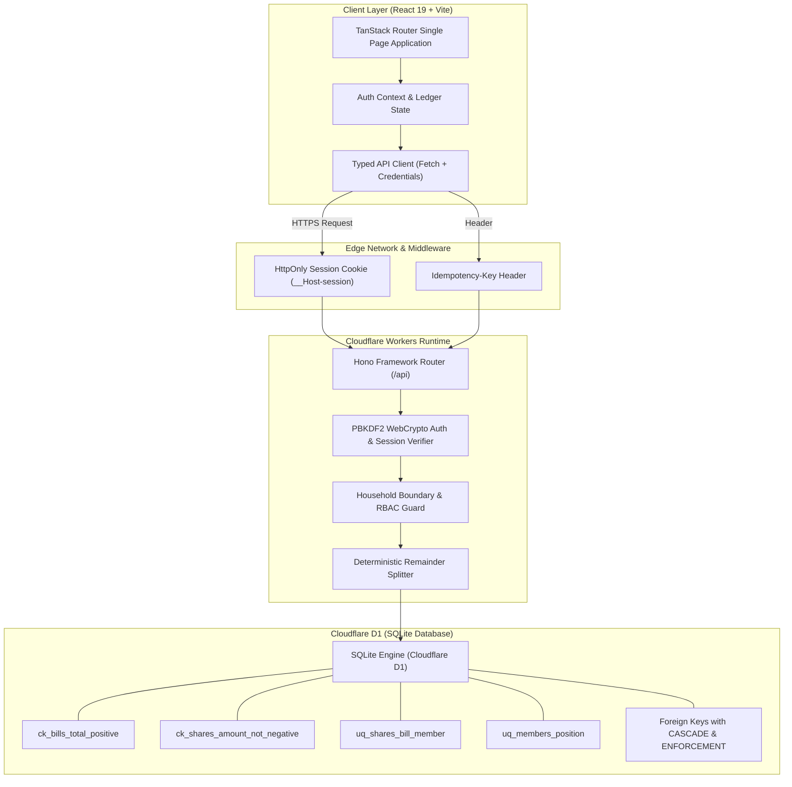
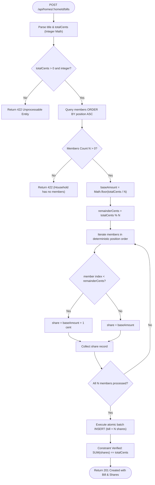
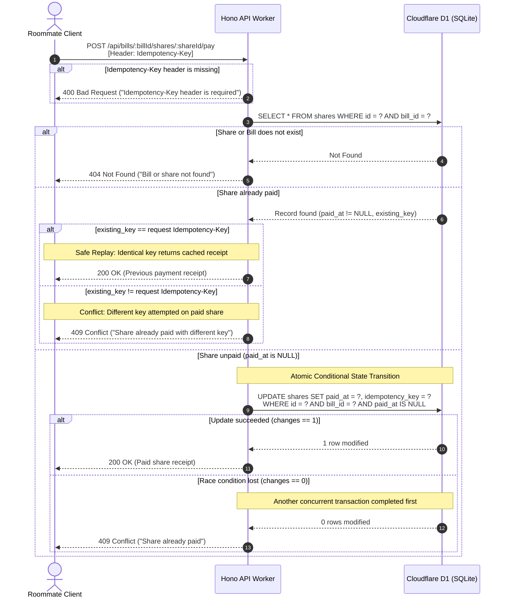
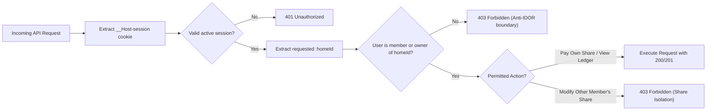

# SDE Intern Assignment: Shared Bill Splitter

---

.

### 1. First-Open Authentication & Onboarding Gate

Every session is secured with native WebCrypto PBKDF2 password hashing and secure `__Host-session` HttpOnly cookies. New roommates can sign in or create an account with real-time character validation.



---

### 2. Real-Time Financial Overview & Analytics

The main dashboard displays real-time key metrics (Total Expenses, Paid Amount, Net Outstanding, Active Roommates), a monthly spending trend chart, expense category distribution, recent household bills, and quick roommate balance snapshots.



---

### 3. Household Bills & Share Breakdown Drawer

Full expense ledger featuring category badges, interactive search, filters (category, status, roommate), and expandable drawers revealing exact per-member share allocations and individual settlement actions.



---

### 4. Household Roommates & Priority Ranks

Displays registered roommates in the exact insertion order that governs deterministic remainder distribution. Each profile shows assigned total, outstanding balance, and a settlement progress meter.



---

### 5. Settlement Balances & Debt Reconciliation

Complete household outstanding balance summary, historical member debt ledger, and actionable "Who Owes Whom" reconciliation guidance.



---

### 6. Household Settings & Identity Management

Clean household configuration showing active apartment name, copyable UUID, registered member count, and authenticated user profile.



---

## Architectural & Workflow Diagrams

### 1. End-to-End System Architecture



---

### 2. Deterministic Bill Splitting & Remainder Allocation Workflow

When an expense cannot be divided evenly to the exact paise (e.g. ₹100 split 3 ways), fractional cents are never rounded away or lost. Surplus cents are distributed one-by-one according to deterministic roommate priority order (`position ASC`).



---

### 3. Payment Concurrency & Idempotency Workflow

Guarantees safe state transitions when network retries occur or when two concurrent requests attempt to settle the same share simultaneously.



---

### 4. Household Boundary & RBAC Isolation Workflow



---

## Assignment Overview

It has two parts:

1. **Homes and members:** create a home and add members to it.
2. **Bill splitting:** split a bill between the members. Each member pays their own share.

The assignment is small on purpose. We want correct, safe, and clear code. We do not want many features.

## What we look at

- **Your code passes the tests.** The tests decide, not opinion. You get the visible tests. We also run extra tests that you do not see.
- **Your code is safe when things go wrong.** Wrong input, repeated requests, and two requests at the same time must not break your data.
- **Your code is typed.** Use TypeScript. Do not use `any`.
- **You understand your code.** You record a short video and explain it.

Take your time. A careful, correct solution is better than a fast one. We expect 2 to 3 days of real work.

## Stack (required)

- **API:** Hono on Cloudflare Workers
- **Database:** Cloudflare D1 (SQLite). The binding is `DB` in `api/wrangler.jsonc`.
- **Web:** React, Vite, TanStack Router
- **Language:** TypeScript on both sides
- **Tests:** Vitest, running inside the Workers runtime
- **Quality:** Biome. `pnpm check` and `pnpm typecheck` must pass.

You choose the rest (styling, form library, validation library). Pick tools you can explain.

## The task

The assignment has two parts. Do Part 1 first. Part 2 builds on it.

**Database.** Write the schema as SQL migration files in `api/migrations/`. For example `0001_init.sql`. The tests apply every file in this folder. Your schema must have **at least 3 named constraints** that protect the data. For example a foreign key, a `CHECK`, or a `UNIQUE` key. Be ready to explain what each constraint stops.

**Errors.** Every error response is JSON: `{ "error": "message" }`.

## Part 1: Homes and members

Create a home and add members to it. The order in which members are added matters in Part 2.

#### `POST /api/homes`

- Request: `{ "name": string }`
- Success: `201` `{ id, name }`

#### `POST /api/homes/:homeId/members`

- Request: `{ "name": string }`
- Success: `201` `{ id, homeId, name }`
- Errors: `404` home not found

Visible tests: `api/test/homes.test.ts`.

## Part 2: Bill splitting

Add a bill to a home, split it between the members, and let each member pay their share.

All amounts are whole **cents** (integers). `100` cents is 1 dollar. Never use decimals for money.

#### `POST /api/homes/:homeId/bills`

- Request: `{ "title": string, "totalCents": number }`
- Success: `201` `{ id, homeId, title, totalCents, shares: [{ id, memberId, amountCents, paidAt: null }] }`
- Errors: `404` home not found. `422` total is not a positive whole number, or the home has no members.

#### `POST /api/bills/:billId/shares/:shareId/pay`

- Request: header `Idempotency-Key`
- Success: `200` `{ id, memberId, amountCents, paidAt }`
- Errors: `400` key missing. `404` bill or share not found. `409` share already paid with a different key.

#### `GET /api/homes/:homeId/balances`

- Success: `200` `{ balances: [{ memberId, name, outstandingCents }] }`
- Errors: `404` home not found

**Rules**

- **Split.** A bill is split between all members of the home. The shares always add up to `totalCents`. If the amount does not divide evenly, the extra cents go to the members one by one, in the order the members were added to the home. Example: 1000 cents between 3 members gives `334`, `333`, `333`.
- **Pay.** Paying marks one share as paid and sets `paidAt`. If the same `Idempotency-Key` is sent again for the same share, answer `200` with the same result. Do not pay twice. If two requests pay the same share at the same time, only one may succeed.
- **Balances.** `outstandingCents` is the sum of the member's unpaid shares, across all bills of the home. List the members in the order they were added.

Visible tests: `api/test/bills.test.ts` and `api/test/payments.test.ts`.

#### Web page

Build one page that:

- shows the bills of a home and the shares of each bill,
- lets a member pay a share,
- shows clear **loading**, **empty**, and **error** states,
- keeps the share unpaid and shows an error if the payment fails.

The page must not crash when the API answers with an error or is slow.

## Cases you must handle

You must handle these cases and talk about them in your video:

1. A home with no members.
2. An amount that is zero, negative, or not a whole number.
3. An amount that does not divide evenly.
4. The same payment request sent twice.
5. Two members paying the same share at the same time.
6. A bill or share that does not exist.
7. The API answers with a 500 error or is slow. The web page must not crash.

## Run it

This is a pnpm workspace. Install once at the root.

```bash
pnpm install
pnpm dev          # api on :8787 and web on :5173
```

Open http://localhost:5173. The starter page shows a title. `/api/health` returns `{ "status": "ok" }`.

```bash
pnpm test         # run the visible tests in api/test
pnpm check        # Biome: format and lint. Must pass.
pnpm check:fix    # fix what Biome can fix
pnpm typecheck    # tsc on both packages. Must pass.
pnpm build        # production build of the web app
```

`pnpm dev` applies your migrations to a local database before it starts the API.

If pnpm says some build scripts were ignored, run `pnpm approve-builds` and allow `esbuild` and `workerd`.

When you change `api/wrangler.jsonc`, refresh the `Env` types:

```bash
pnpm --filter bill-splitter-api cf-typegen
```

## Rules for the tests

- The visible tests are in `api/test`. They start with a failing result. Your job is to make them pass.
- Do **not** change the visible tests or `api/test/helpers.ts`. We compare them with the original.
- We run extra tests after you submit. They test the cases in "Cases you must handle" more closely.

## AI policy

You can use AI tools. Tell us which ones and where in your answers on the form.
You must understand every line you submit. We check this with your video and in a live call. "The AI wrote it" is not an answer.

## How to submit

1. Click **Use this template**, then **Create a new repository**. Make the repository **public**.
2. Build your solution in your new repository. Small, clear commits are welcome.
3. Update this README with a short section called **Decisions**. Write 3 decisions you made and why.
4. Record a video of **3 minutes or less** (Loom or unlisted YouTube). Show the architecture, the data flow, and one trade-off you made. Make sure anyone with the link can view it.
5. Paste the repository link and the video link in the application form.

We will run `pnpm install && pnpm check && pnpm typecheck && pnpm test` on your repository.

## Decisions

### 1. Integer Cent Representation & Deterministic Remainder Distribution

- **Decision:** All monetary values are strictly represented and calculated in integer cents (`total_cents`, `amount_cents`). Remainder cents from division (`totalCents % members.length`) are allocated one-by-one in the strict order members were added (`members.position ASC`).
- **Why:** Floating-point math introduces binary precision errors that are unacceptable in financial ledgers. Integer cents guarantee exact mathematical conservation ($\sum \text{shares} = \text{total}$) across all values, including small amounts and uneven divisions.

### 2. Atomic Idempotency & Concurrency Control

- **Decision:** The share payment endpoint enforces an `Idempotency-Key` header and performs an atomic conditional update:
  `UPDATE shares SET paid_at = ?, idempotency_key = ? WHERE id = ? AND bill_id = ? AND paid_at IS NULL`.
- **Why:** Network retries and concurrent user requests can lead to double-payments. With this atomic check, SQLite/D1 executes the state transition safely: the first request succeeds (or duplicate requests with the identical key safely replay the existing payment receipt with 200 OK), while conflicting concurrent requests or mismatched keys are rejected with 409 Conflict.

### 3. Named Defensive Database Constraints

- **Decision:** Five named constraints protect data integrity directly in D1/SQLite:
  1. `ck_bills_total_positive`: Ensures `total_cents > 0` and is an integer.
  2. `ck_shares_amount_not_negative`: Ensures `amount_cents >= 0` (supporting valid zero-cent shares for micro-totals).
  3. `uq_shares_bill_member`: Prevents duplicate shares for the same member on a bill.
  4. `uq_members_position`: Preserves deterministic FIFO member positions per home.
  5. Foreign keys (`fk_members_home`, `fk_bills_home`, etc.) to prevent orphan records.
- **Why:** Database constraints act as an unbreakable layer of defense against corrupted state, buggy migrations, or unexpected race conditions.
